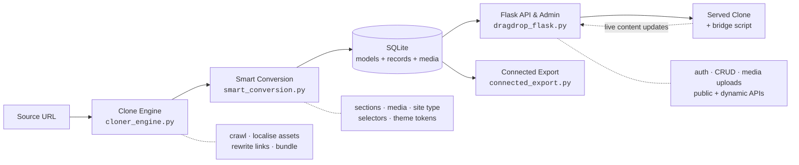

<div align="center">

# AI Website Fabricator

**Clone any public website, auto-generate a CMS for it, and edit the live clone through a real admin panel.**

[](https://www.python.org/)
[](https://streamlit.io/)
[](https://flask.palletsprojects.com/)
[](https://www.sqlite.org/)
[](LICENSE)

[Overview](#overview) · [How it works](#how-it-works) · [Quick start](#quick-start) · [Architecture](#architecture) · [API](#api-surface) · [Docs](#documentation)

</div>

---

## Overview

Recreating an existing website normally means one of two bad options: rebuild it by hand (slow, and the design drifts), or generate it with an LLM (fast, but it invents a site instead of reproducing one).

**AI Website Fabricator takes a third path.** It clones the *real* site deterministically, then analyses the cloned DOM to infer a content model — sections, media, navigation, theme tokens — and stands up a working admin panel on top of it. Edits made in the admin panel are pushed back into the served clone through an injected bridge script, so a cloned page becomes an editable, CMS-backed site.

| | |
|---|---|
| **Problem** | Cloned websites are static dead ends — you can look at them, but you can't manage or evolve their content. |
| **Approach** | Deterministic crawl + asset localisation → DOM-driven content-model inference → generated CRUD admin → live bridge back into the clone. |
| **Result** | A browsable local copy of a site with a per-site admin panel, REST API, media library, and a standalone exportable build. |

> **Scope note:** this is a local-first research/engineering project built around a full pipeline, not a hosted SaaS. It targets `127.0.0.1` and stores everything in a local SQLite database.

---

## How it works



**1. Clone** — a breadth-first crawler walks internal pages (sitemap-aware, with JS-navigation heuristics), downloads HTML, CSS, JS, images, fonts and icons, rewrites every URL to a local path, and persists the result as a versioned bundle.

**2. Convert** — the cloned DOM is analysed to detect the site type (e-commerce, restaurant, portfolio, news…), split the page into semantic sections, build stable CSS selectors for each, extract and localise media assets, and derive theme tokens (colours, fonts, logo, favicon). This produces a *conversion blueprint* and a *SiteSpec* with a transparent, weighted confidence breakdown.

**3. Manage** — the SiteSpec is materialised into dynamic models and records in SQLite and exposed through a token-authenticated, per-site admin API with full CRUD, publishing, and a media library.

**4. Bridge** — served clone pages get a bridge script injected and no-cache headers applied, so admin edits resolve against the page's stored selectors and appear in the clone on refresh.

**5. Export** — `connected_export.py` packages a site into a standalone, self-hosting build with its data layer attached.

---

## Feature highlights

- **Deterministic clone engine** — parallel asset fetching, `srcset`/CSS-`url()`/meta-refresh resolution, sitemap discovery, collision-safe local paths, and per-run diagnostics.
- **Content-model inference** — sections, fields and records are derived from the actual DOM, not guessed from a prompt.
- **Selector-based live bridge** — edits map back to the exact element they came from.
- **Per-site scoped auth** — signed tokens (`itsdangerous`) scope every admin request to a single site.
- **Media pipeline** — assets are detected, classified, localised, indexed, and re-uploadable through the admin API.
- **Transparent confidence scoring** — clone quality is reported as a weighted breakdown (page coverage, asset localisation, media indexing, section quality, site-type confidence), not a single opaque number.
- **Verification harness** — fast/deep clone comparison runs are captured in [`docs/notes/clone_verification_report.json`](docs/notes/clone_verification_report.json).

---

## Quick start

**Requirements:** Python 3.10+

```bash
# 1. Clone and enter the repository
git clone https://github.com/ahsaan-10/aa---wc.git
cd aa---wc

# 2. Create an isolated environment
python -m venv .venv
source .venv/bin/activate        # Windows: .venv\Scripts\activate

# 3. Install dependencies
pip install -r requirements.txt
```

Run the two processes in **separate terminals**:

```bash
# Terminal 1 — Flask runtime, API and admin host  →  http://127.0.0.1:5001
python dragdrop_flask.py

# Terminal 2 — Streamlit operator console         →  http://127.0.0.1:8501
python -m streamlit run app.py
```

Convenience launchers live in [`scripts/`](scripts/) — `start_backend.sh` / `start_cloner.sh` on macOS and Linux, `start_backend.bat` / `start_cloner.bat` / `start_all.bat` on Windows.

| Surface | URL |
|---|---|
| Operator console (clone + convert) | `http://127.0.0.1:8501` |
| Site-scoped admin login | `http://127.0.0.1:5001/admin/site/<site_id>/login` |
| Clone preview | `http://127.0.0.1:5001/clone/<site_id>/` |
| Public content API | `http://127.0.0.1:5001/api/public/<site_id>/<resource>` |

A step-by-step demo walkthrough is in **[docs/DEMO_RUNBOOK.md](docs/DEMO_RUNBOOK.md)**.

---

## Architecture

| Module | Lines | Responsibility |
|---|---:|---|
| [`app.py`](app.py) | ~3,070 | Streamlit operator console: clone runs, conversion, previews, diagnostics |
| [`cloner_engine.py`](cloner_engine.py) | ~2,290 | Crawling, asset localisation, URL rewriting, bundle persistence |
| [`smart_conversion.py`](smart_conversion.py) | ~1,760 | Site-type detection, section/media extraction, selectors, bridge injection |
| [`dragdrop_flask.py`](dragdrop_flask.py) | ~2,010 | Flask host: auth, admin CRUD, media, public + dynamic APIs, clone serving |
| [`connected_export.py`](connected_export.py) | ~1,220 | Standalone self-hosting export builder |
| [`prepare_demo.py`](prepare_demo.py) | ~130 | Seeds a deterministic demo user and assigns sites |

### Data model

One shared SQLite database backs both the operator and admin surfaces:

`users` · `cloned_sites` · `conversion_blueprints` · `site_specs` · `dynamic_models` · `dynamic_records` · `media_assets`

### Repository layout

```
.
├── app.py                   # Streamlit operator console
├── cloner_engine.py         # Crawl + asset localisation
├── smart_conversion.py      # DOM → content model
├── dragdrop_flask.py        # Flask API, admin host, clone server
├── connected_export.py      # Standalone export builder
├── prepare_demo.py          # Demo data seeding
├── requirements.txt
├── scripts/                 # Cross-platform launchers (.sh / .bat)
├── tools/                   # Documentation PDF generators
└── docs/
    ├── MASTER_DOCUMENTATION.md   # Code-grounded technical reference
    ├── DEMO_RUNBOOK.md           # Step-by-step demo walkthrough
    ├── diagrams/                 # draw.io diagram pack + guide
    ├── notes/                    # Engineering notes & verification output
    └── academic/                 # Milestone report, jury brief, source material
```

---

## API surface

27 routes across four groups, all served by `dragdrop_flask.py`:

| Group | Representative routes | Purpose |
|---|---|---|
| **Admin auth** | `POST /api/admin/login`, `GET /api/admin/me` | Signed per-site session tokens |
| **Admin CRUD** | `GET·POST /api/admin/<site_id>/<resource>`<br/>`PATCH·DELETE /api/admin/<site_id>/<resource>/<id>`<br/>`PATCH …/<id>/publish` | Record management and publishing |
| **Media** | `GET·POST /api/admin/<site_id>/media`<br/>`PATCH·DELETE /api/admin/<site_id>/media/<id>`<br/>`GET /media/<site_id>/<filename>` | Multipart upload, indexing, serving |
| **Public / dynamic** | `GET /api/public/<site_id>/<resource>`<br/>`GET /dynamic-api/<site_id>/meta`<br/>`GET·POST·PUT·DELETE /dynamic-api/<site_id>/<model>` | Read APIs consumed by the clone bridge |
| **Clone serving** | `GET /clone/<site_id>/<path>`, `GET /clone/<site_id>/export.zip` | Bridge-injected, no-cache clone delivery |

---

## Documentation

| Document | What's in it |
|---|---|
| [Master Documentation](docs/MASTER_DOCUMENTATION.md) | Code-grounded reference for the full pipeline — the deepest technical write-up |
| [Demo Runbook](docs/DEMO_RUNBOOK.md) | Exact sequence to run and demonstrate the end-to-end flow |
| [Diagram Pack](docs/diagrams/DIAGRAMS_GUIDE.md) | Component, deployment and operational diagrams (`.drawio`) |
| [Engineering Notes](docs/notes/) | Clone-quality/confidence rework, admin-panel gap analysis, verification data |
| [Milestone Report](docs/academic/M3_REPORT.md) | Full project report: background, design, implementation, testing |

---

## Current limitations

Stated honestly, because they shape what the demo can show:

- **Local-first.** Everything binds to `127.0.0.1` and SQLite; there is no multi-tenant deployment story yet.
- **Selector-dependent updates.** Visible DOM updates rely on selector quality captured at conversion time. When a selector misses on a specific section, the change is still visible through the public API but may not repaint in the preview.
- **The React admin SPA (`admin/src`, built to `admin/dist`) is not committed to this repository.** The Flask admin API and its routes are fully present; the frontend bundle is built separately.
- **Best-effort cloning.** Heavily client-rendered sites clone less completely than server-rendered ones.

## Roadmap

- [ ] Commit the React admin frontend alongside the backend
- [ ] Automated test suite for the clone → convert → serve pipeline
- [ ] Containerised (Docker Compose) setup
- [ ] Replace the hard-coded token secret with environment-based configuration
- [ ] Headless-browser rendering pass for client-rendered sites

---

## License

Released under the [MIT License](LICENSE).

<div align="center">
<sub>Built by <a href="https://github.com/ahsaan-10">@ahsaan-10</a></sub>
</div>
