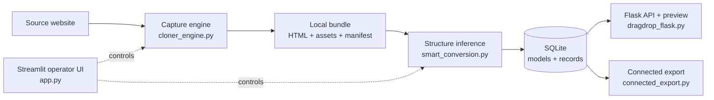

# Website Fabricator

**Capture a website, infer its structure, and turn it into editable, API-backed content.**


---

## Overview

Website Fabricator is a Python prototype that takes a static website and re-engineers it into a content-managed one. It downloads the pages and assets, works out what the site is made of (pages, sections, navigation, repeated content such as cards or team members), and stores that structure as data models that can be edited through an API and previewed live.

**Why it is interesting:** it combines web scraping, HTML structure inference, data modelling, and a REST backend into one end-to-end pipeline.

## Key features

| Feature | What it does |
| --- | --- |
| **Site capture** | Crawls a site, downloads HTML, CSS, images and fonts, and rewrites links so the copy works offline. |
| **Structure inference** | Detects pages, sections, navigation, theme settings, and repeated content blocks, then proposes data models for them. |
| **Editable content** | Saves inferred models and records in SQLite and exposes them through Flask CRUD endpoints. |
| **Live preview** | Serves the captured site with edits applied, so changes are visible immediately. |
| **Connected export** | Packages a site, its data, and a standalone Flask server into a portable bundle. |

## How it works



1. **Capture:** the operator enters a URL in the Streamlit app; the capture engine saves a local, link-rewritten bundle.
2. **Infer:** the conversion module analyses the bundle and builds a site spec (pages, sections, models).
3. **Edit:** models and records are stored in SQLite and served through the Flask API.
4. **Preview and export:** edits show up in the live preview and can be exported as a standalone package.

A full code-level walkthrough is in **[docs/architecture.md](docs/architecture.md)**.

## Tech stack

**Python** · **Streamlit** (operator UI) · **Flask** + Flask-CORS (REST API and preview server) · **Requests** + **Beautiful Soup** (capture and parsing) · **SQLite** (storage)

## Project structure

```text
website-fabricator/
├── app.py                 # Streamlit operator interface (entry point)
├── cloner_engine.py       # Capture, asset download, link rewriting, bundling
├── smart_conversion.py    # Structure inference and data-model generation
├── dragdrop_flask.py      # Flask API, live preview, and admin routes
├── connected_export.py    # Standalone export packaging
├── prepare_demo.py        # Sets up a local demo account and sample data
├── requirements.txt
├── docs/
│   ├── architecture.md              # Detailed technical documentation
│   ├── code-flow.pdf                # Printable code-flow overview
│   ├── diagrams.drawio              # Editable architecture diagrams
│   ├── clone-verification-report.json
│   ├── media-confidence-fix.md
│   └── admin-panel-gap-analysis.md
└── scripts/
    ├── start_all.bat      # Windows: start the operator UI
    ├── start_cloner.bat   # Windows: Streamlit only
    ├── start_backend.bat  # Windows: Flask API only
    └── start_admin.bat    # Windows: API + open admin URL
```

## Getting started

**Requirements:** Python 3.10 or newer.

```bash
git clone https://github.com/ahsaan-10/website-fabricator.git
cd website-fabricator
python -m venv .venv
# Windows: .venv\Scripts\activate    macOS/Linux: source .venv/bin/activate
pip install -r requirements.txt
```

Start the two services in separate terminals:

```bash
python -m streamlit run app.py     # Operator UI  → http://localhost:8501
python dragdrop_flask.py           # API/preview  → http://localhost:5001
```

Start the Streamlit app first: it creates the local `users.db` database on its first run.

## Status and limitations

This is a working **prototype**, not a production product.

- The capture, inference, API, and export modules are complete and included.
- The separate React admin dashboard (`admin/`) is **not** included, so `/admin` routes return a "build not found" message.
- JavaScript-heavy sites and pages behind a login are only partly supported, because capture is HTTP-based.
- It infers structure and starter content; it does not recreate a site's private backend.

> Only capture websites you own or have permission to use.

## Related work

[web-cloner](https://github.com/ahsaan-10/web-cloner) is the earlier, simpler version of this project (archived).

## License

Released under the [MIT License](LICENSE).
