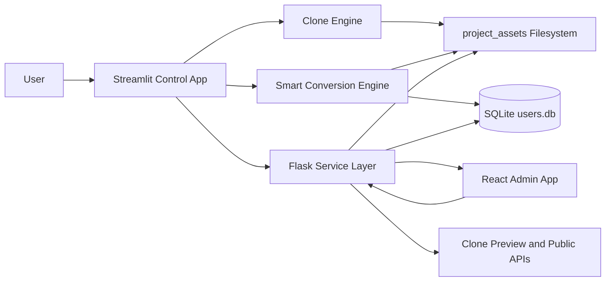
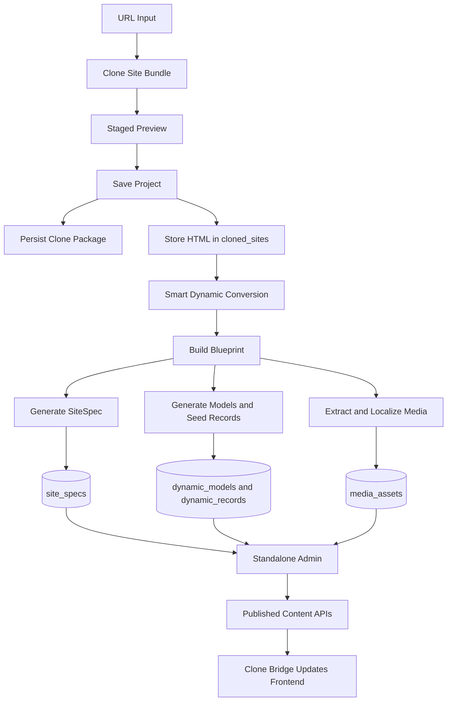
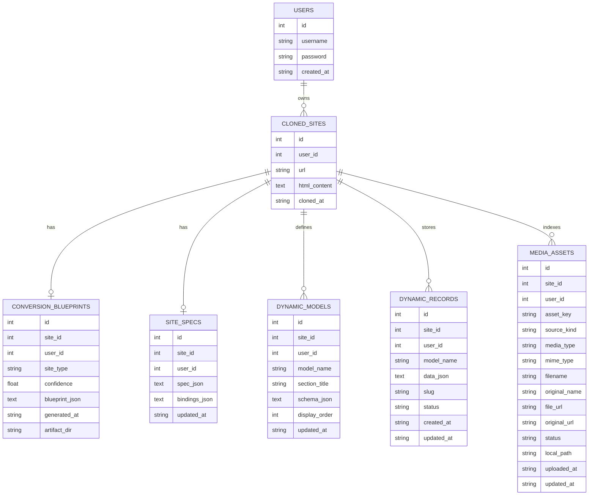
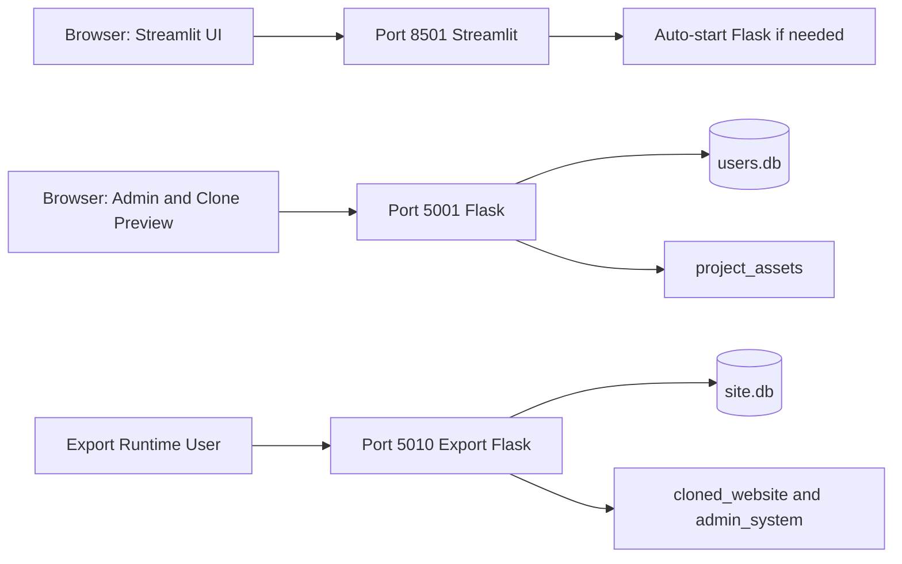
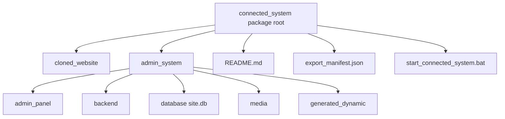

# AI Website Fabricator: Master Documentation Pack

This document is the code-grounded source of truth for the current AI Website Fabricator project. It is designed to be directly reusable for:

- formal report writing
- updated architecture and flow diagrams
- PPT slide creation
- future LLM prompting

All technical statements in this document are derived from the current working codebase, primarily:

- [app.py](../app.py)
- [cloner_engine.py](../cloner_engine.py)
- [smart_conversion.py](../smart_conversion.py)
- [dragdrop_flask.py](../dragdrop_flask.py)
- [connected_export.py](../connected_export.py)
- `admin/src/App.tsx`
- `admin/src/components/AdminShell.tsx`
- `admin/src/pages/ProjectDetailPage.tsx`
- `admin/src/pages/ResourceListPage.tsx`
- `admin/src/pages/RecordEditorPage.tsx`
- `admin/src/pages/MediaPage.tsx`

Older milestone notes are referenced only as historical context where useful. They are not treated as the implementation source of truth.

## 1. Project Overview

### 1.1 What the system is

AI Website Fabricator is a local website re-engineering platform. It does not simply copy a site's visual output. Instead, it performs a full transformation pipeline:

1. Clone a live website into a local multi-page static bundle.
2. Preserve that clone for preview, HTML editing, and drag-and-drop editing.
3. Analyze the cloned HTML to infer structure, content collections, media, sections, and likely website type.
4. Generate a schema-driven content layer called `SiteSpec`.
5. Seed structured records and indexed media into SQLite.
6. Expose management APIs and public content APIs through Flask.
7. Serve a separate React admin website for content, structure, media, and publishing.
8. Optionally package the clone, admin, backend, media, and database into a portable connected export ZIP.

### 1.2 What problem it solves

The project solves the problem of turning a static or manually designed website into a manageable CMS-like system without rebuilding the site from scratch. Its practical goals are:

- preserve the original frontend as much as possible
- make content editable through structured resources
- allow technical users to edit raw HTML directly
- allow non-technical users to manage content through a separate admin panel
- localize media and keep a media library
- export the connected system for standalone running outside the main project

### 1.3 Current implementation stack

#### Backend and orchestration

- `Python`
- `Streamlit`
- `Flask`
- `Flask-CORS`
- `requests`
- `BeautifulSoup4`
- `sqlite3`
- `itsdangerous`

#### Frontend admin

- `React`
- `TypeScript`
- `Vite`
- `React Router`

#### Persistence and file storage

- `SQLite` in `users.db`
- filesystem storage under `project_assets/`

#### Visual editing

- raw HTML editing in Streamlit
- GrapesJS-based drag-and-drop builder served by Flask

### 1.4 What is included in the current working version

The current codebase supports:

- user registration and login
- deep and fast site cloning
- staged clone preview before saving
- saved clone package persistence
- downloadable clone ZIP export
- raw HTML code editing and live preview
- drag-and-drop editing
- Smart Dynamic Conversion from clone to CMS-ready structure
- site type detection
- media extraction and localization
- dynamic model and seed record generation
- `SiteSpec` generation
- separate site-scoped admin website
- publish/draft workflow
- media upload, replace, preview, and delete
- public content endpoints for published records
- standalone connected system export

## 2. System Architecture

### 2.1 High-level architecture

The project is split into five major runtime layers:

1. `Streamlit control layer`
   - the main operator dashboard
   - used for cloning, saving, editing, converting, and exporting

2. `Clone and inference layer`
   - clone engine in `cloner_engine.py`
   - conversion/inference engine in `smart_conversion.py`

3. `Persistence layer`
   - `users.db` plus generated files and media under `project_assets/`

4. `Flask service layer`
   - serves clone previews, editor routes, static admin files, APIs, media files, and public endpoints

5. `Standalone React admin layer`
   - site-scoped CMS user interface driven by `SiteSpec`

### 2.2 Main subsystem roles

#### Streamlit

- acts as the control dashboard
- owns user login/registration flow
- launches cloning
- stores saved projects
- exposes raw HTML editing
- triggers Smart Dynamic Conversion
- shows conversion summaries
- triggers connected export generation

#### Flask

- serves the GrapesJS visual editor
- serves staged and persisted clone previews
- serves clone ZIP downloads
- serves the built admin frontend
- hosts authenticated admin APIs
- hosts public read-only content APIs
- hosts general dynamic collection APIs
- serves localized media files

#### React admin

- provides the separate CMS experience
- authenticates with the Flask admin login endpoint
- loads `SiteSpec` and project metadata
- renders resource navigation and forms from the generated schema
- manages records, publish state, and media

#### SQLite

- stores users
- stores cloned sites
- stores generated blueprint metadata
- stores `SiteSpec`
- stores dynamic models
- stores dynamic records
- stores media records

#### Filesystem storage

- stores staged clone bundles
- stores saved clone packages and ZIPs
- stores localized media
- stores generated dynamic artifacts
- stores connected export packages

### 2.3 Runtime ports and interaction boundaries

#### Main project runtime

- Streamlit app: `http://127.0.0.1:8501`
- Flask backend/editor/admin host: `http://127.0.0.1:5001`

#### Export runtime

- connected export backend: usually `http://127.0.0.1:5010`
- if port `5010` is busy, the exported backend picks the next free port and prints the final URLs

### 2.4 Startup and helper scripts

- [start_cloner.bat](../scripts/start_cloner.bat): runs the Streamlit app
- [start_backend.bat](../scripts/start_backend.bat): runs the Flask backend
- [start_admin.bat](../scripts/start_admin.bat): starts backend and opens the site-specific admin URL
- [start_all.bat](../scripts/start_all.bat): starts the cloner-related flow and prints key URLs

## 3. Complete End-to-End Flow

### 3.1 User registration and login flow

1. The user opens the Streamlit app.
2. If not authenticated, `login_page()` in `app.py` is shown.
3. Registration writes a new row into `users` with a SHA-256 password hash.
4. Login checks username and hashed password against `users`.
5. On success, Streamlit stores `logged_in` and `user_info` in session state.
6. The main application UI becomes available.

### 3.2 Cloning flow

1. The user enters a target URL in `Clone New Site`.
2. The user selects `Deep Clone` or `Fast Clone`.
3. `scrape_website()` calls `clone_site_bundle()` from `cloner_engine.py`.
4. The clone engine:
   - normalizes the root URL
   - crawls internal pages
   - downloads assets
   - rewrites page and asset references
   - builds a local clone bundle
   - writes a manifest
   - creates a clone ZIP
5. Streamlit stores the clone result in session state as the current staged clone.

### 3.3 Staged preview flow

1. After a successful clone, the clone is previewed before being persisted.
2. Streamlit embeds the Flask route `/staged-clone/<clone_key>/`.
3. Flask serves the staged bundle directly from the temporary clone workspace.
4. The user can inspect the clone before saving it into the project database.

### 3.4 Save-to-project flow

1. The user clicks `SAVE TO PROJECT DATABASE`.
2. `save_site_to_db()` inserts a row into `cloned_sites`.
3. `persist_bundle_for_site()` copies the staged bundle into `project_assets/clone_packages/site_<id>/`.
4. The original entry HTML is persisted in `cloned_sites.html_content`.
5. The clone now becomes a managed saved project.

### 3.5 Raw HTML editing flow

1. The user opens `Manage My Sites`.
2. Streamlit lists all saved clones for the current user.
3. The selected site's HTML is loaded with `get_html_by_id()`.
4. If a saved clone package exists, bundle preview HTML is preferred for rendering.
5. The HTML is shown in a Streamlit text area and a live rendered preview.
6. `Commit Changes` calls `update_html_in_db()`.
7. HTML is stored back into `cloned_sites`.
8. The clone bridge is re-injected unless explicitly skipped.
9. Saved bundle entry HTML is updated to keep the filesystem clone aligned.

### 3.6 Drag-and-drop builder flow

1. The user opens `Drag & Drop Builder`.
2. Streamlit ensures Flask is running on port `5001`.
3. Streamlit opens the Flask landing page in an iframe with `?user_id=<id>`.
4. Flask lists only that user's cloned sites.
5. The user opens the editor for a specific site.
6. Flask injects the stored or bundle HTML into the GrapesJS-based editor.
7. Saving from the editor updates the site's HTML in the database and saved bundle.

### 3.7 Smart Dynamic Conversion flow

1. The user selects a saved clone in `Smart Dynamic Conversion`.
2. The user chooses an admin theme.
3. The user clicks `Generate Database + Admin Panel`.
4. `generate_clone_runtime()` performs the conversion pipeline:
   - build blueprint
   - load saved clone bundle context
   - localize media
   - apply bundle context
   - create generated artifact files
   - build `SiteSpec`
   - update stored site HTML
   - save conversion blueprint
   - save `SiteSpec`
   - rebuild dynamic models and records
   - sync media assets into `media_assets`
5. The result is now available for the React admin and public APIs.

### 3.8 Separate admin flow

1. After conversion, Streamlit shows a site-specific admin URL such as `/admin/site/<site_id>/login`.
2. Flask serves the built React app from `admin/dist`.
3. The admin frontend sends credentials to `/api/admin/login`.
4. Flask validates against `users` and returns a signed bearer token.
5. The admin frontend stores the token and current user in localStorage.
6. The admin shell loads project metadata and `SiteSpec` from `/api/projects/<site_id>/spec`.
7. Resource pages and forms are rendered dynamically from the `SiteSpec`.
8. Users can edit, create, delete, publish, and manage media for that one site.

### 3.9 Connected export flow

1. From the Smart Dynamic Conversion screen, the user clicks `Build Connected Download Package`.
2. `build_connected_export()` validates that:
   - admin build exists
   - saved clone package exists
   - generated dynamic artifacts exist
3. It creates a package containing:
   - cloned website
   - admin frontend build
   - generated backend runtime
   - site-scoped SQLite database
   - media
   - generated schema/spec artifacts
4. A ZIP archive is created under `project_assets/connected_exports/site_<id>/`.
5. The exported system can be run independently via `start_connected_system.bat`.

## 4. Module-by-Module Code Explanation

### 4.1 `app.py`

#### Purpose

`app.py` is the main Streamlit application and orchestration layer. It coordinates authentication, cloning, project management, dynamic conversion, and export operations.

#### Main responsibilities

- initialize database tables
- manage user registration/login
- start Flask if needed
- save and update cloned projects
- run the clone engine
- run Smart Dynamic Conversion
- trigger connected export generation
- expose operator-facing UI workflows

#### Key functions

- `init_db()`: creates and migrates SQLite tables
- `create_user()`: registers a new user
- `login_user()`: validates login
- `ensure_flask_running()`: starts Flask on demand
- `save_site_to_db()`: persists a saved clone
- `get_user_sites()`: lists saved sites for the user
- `get_html_by_id()`: loads project HTML, optionally bundle preview HTML
- `update_html_in_db()`: updates saved HTML and bridge injection
- `generate_clone_runtime()`: full clone-to-CMS conversion pipeline
- `save_conversion_blueprint()`: saves blueprint metadata
- `save_site_spec()`: saves generated `SiteSpec`
- `rebuild_dynamic_site_data()`: rebuilds dynamic models and seed records
- `sync_media_assets()`: synchronizes clone media into `media_assets`
- `main_app()`: renders the authenticated Streamlit application
- `login_page()`: renders login/registration UI

#### Inputs and outputs

- inputs: URL, selected project, selected theme, edited HTML, clone mode, user actions
- outputs: saved DB rows, generated files, localized media, admin URLs, connected export ZIPs

#### Connections to other modules

- calls `cloner_engine.py` for site cloning and bundle persistence
- calls `smart_conversion.py` for blueprint, spec, and scaffolding
- calls `connected_export.py` for portable package creation
- starts and depends on `dragdrop_flask.py` for previews, admin, and APIs

### 4.2 `cloner_engine.py`

#### Purpose

`cloner_engine.py` implements the custom multi-page clone engine. It is responsible for collecting pages and assets, rewriting them into a portable local site, and producing preview/persistence artifacts.

#### Main responsibilities

- normalize URLs
- crawl internal pages
- discover navigation targets
- read sitemap hints when available
- download and deduplicate assets
- rewrite page links and asset references
- rewrite CSS `@import` and `url()` references
- build local page output paths
- build a bundle manifest
- create clone ZIP archives
- support staged clone previews and persisted clone packages

#### Key functions

- `normalize_source_url()`: canonicalizes URLs
- `crawl_site_pages()`: crawls same-domain HTML pages
- `collect_internal_navigation_urls()`: finds internal navigation links
- `clone_binary_asset()`: downloads and stores non-CSS assets
- `clone_stylesheet_asset()`: downloads and rewrites stylesheets
- `rewrite_css_text()`: localizes referenced CSS assets
- `rewrite_page_html()`: rewrites links, scripts, media, and inline styles
- `inject_navigation_bridge()`: preserves navigation behavior during clone rewrite
- `write_bundle_manifest()`: persists clone metadata
- `create_bundle_archive()`: creates ZIP exports
- `clone_site_bundle()`: complete clone orchestration
- `persist_bundle_for_site()`: copies staged clone into a permanent package directory
- `prefix_preview_paths()` and `strip_preview_paths()`: manage preview path rewriting
- `load_saved_bundle_entry()`: loads the main saved bundle HTML entry

#### Inputs and outputs

- input: root URL, crawl depth/page limits, progress callback
- output: local clone bundle, asset files, page files, manifest, archive, diagnostics

#### Connections to other modules

- used by `app.py` for clone operations
- used by `dragdrop_flask.py` for bundle serving and entry updates
- used by `connected_export.py` to package saved clone contents

### 4.3 `smart_conversion.py`

#### Purpose

`smart_conversion.py` is the inference and transformation engine that converts cloned HTML into a CMS-ready blueprint and `SiteSpec`.

#### Main responsibilities

- detect website type
- extract media
- localize media references
- inject frontend bridge script
- extract navigation
- extract forms
- extract semantic site sections
- infer content models from site type
- generate seed records
- generate backend route plans
- generate admin section plans
- compute clone confidence breakdown
- generate `SiteSpec`
- create artifact files for the converted site

#### Key functions

- `detect_site_type()`: keyword-based site type classification
- `extract_media_assets()`: detects and optionally downloads images, icons, SVGs, audio, video, CSS backgrounds, and lazy assets
- `materialize_media_asset()`: downloads and stores media
- `localize_clone_html()`: replaces original media references with localized files
- `inject_clone_bridge()`: injects runtime script that pulls public content APIs into the cloned frontend
- `extract_navigation()`: identifies menu/navigation items
- `extract_forms()`: detects forms and submission-style models
- `extract_sections()`: identifies editable content sections
- `extract_content_models()`: generates resource models based on site type plus system models
- `extract_seed_records()`: creates initial records from extracted content
- `calculate_confidence_breakdown()`: scores clone quality using weighted components
- `build_site_spec()`: creates the final `SiteSpec` contract
- `build_conversion_blueprint()`: main inference pipeline
- `create_scaffold_files()`: writes generated artifacts to disk

#### Inputs and outputs

- input: site URL, cloned HTML, site ID, optional media output directory
- output: blueprint JSON, localized HTML, models, seed records, media manifest, diagnostics, `SiteSpec`

#### Connections to other modules

- called by `app.py` during Smart Dynamic Conversion
- its bridge logic is relied on by clone previews and exported runtimes
- its generated artifacts are consumed by both Flask and the connected export packager

### 4.4 `dragdrop_flask.py`

#### Purpose

`dragdrop_flask.py` is the main service layer. It provides editor routes, static serving, clone previews, admin APIs, public APIs, dynamic APIs, and media serving.

#### Main responsibilities

- initialize dynamic tables and migrations
- authenticate admin users
- serve visual editing pages
- save edited HTML
- preview staged and saved clone bundles
- serve clone ZIP downloads
- serve the built React admin application
- expose project/spec/resource/media/public/dynamic APIs
- serve localized media files

#### Key functions

- `get_db_connection()`: SQLite connection helper
- `require_admin_auth()`: bearer-token protection wrapper
- `ensure_dynamic_tables()`: creates and migrates conversion-related tables
- `serve_clone_directory()`: static serving for clone directories
- `serve_admin_app()`: serves built admin frontend from `admin/dist`
- `admin_login()`: authenticates admin users
- `api_projects()`: lists current user's projects
- `api_project_spec()`: returns site-scoped `SiteSpec` and resource counts
- `admin_resource()`: list/create records for one resource
- `admin_resource_item()`: update/delete a single record
- `admin_publish_record()`: publish/draft toggle
- `admin_media()`: list/upload media
- `admin_media_item()`: replace/delete/update media
- `public_resource()`: returns only published content for one resource
- `dynamic_meta()`: exposes inferred collection metadata
- `dynamic_collection()` and `dynamic_item()`: generic collection read/write endpoints

#### Inputs and outputs

- inputs: HTTP requests from Streamlit iframes, browser previews, admin frontend, and clone bridge scripts
- outputs: HTML pages, JSON payloads, media files, clone ZIPs, updated DB records

#### Connections to other modules

- reads and writes the same SQLite database initialized by `app.py`
- serves data generated by `smart_conversion.py`
- serves clone content produced by `cloner_engine.py`
- serves the admin frontend built from `admin/src`

### 4.5 `connected_export.py`

#### Purpose

`connected_export.py` packages a site-specific connected system that can run outside the main repository.

#### Main responsibilities

- load site context from the main DB
- copy saved clone bundle into package form
- copy built admin frontend
- copy generated conversion artifacts
- copy localized media
- create a site-specific database subset
- generate a standalone Flask backend runtime
- generate README and start scripts
- create a ZIP archive

#### Key functions

- `load_site_export_context()`: reads site, user, blueprint, and spec data
- `sync_export_clone_html()`: updates exported clone HTML and injects bridge into pages
- `export_site_database()`: copies only the needed tables and rows into a smaller SQLite DB
- `write_backend_runtime()`: writes a self-contained Flask runtime
- `write_export_docs()`: writes README, manifest, and startup scripts
- `build_connected_export()`: full export orchestration

#### Inputs and outputs

- input: `site_id`, `user_id`, project root
- output: packaged folder tree plus connected ZIP archive

#### Connections to other modules

- depends on saved clone packages from `cloner_engine.py`
- depends on generated artifacts from `smart_conversion.py`
- depends on persisted DB state created by `app.py`

### 4.6 `admin/src/*`

#### Purpose

The `admin/src` folder contains the standalone React admin application used for content operations on one cloned site at a time.

#### Major files

- `App.tsx`: defines routing and redirects
- `components/AdminShell.tsx`: main layout, site navigation, theme mode, project refresh
- `components/ProtectedRoute.tsx`: route protection based on stored token
- `lib/api.ts`: API client wrappers for login, projects, resources, and media
- `lib/auth.ts`: localStorage token and user helpers
- `lib/themes.ts`: admin theme definitions and theme lookup
- `types.ts`: shared frontend types for projects, `SiteSpec`, records, and media
- `pages/LoginPage.tsx`: admin login page
- `pages/ProjectDetailPage.tsx`: site overview, counts, diagnostics, resource summary
- `pages/ResourceListPage.tsx`: list/filter/publish/delete records
- `pages/RecordEditorPage.tsx`: create/edit resource records using `SiteSpec` fields
- `pages/MediaPage.tsx`: list/preview/upload/replace/delete media

#### Input and output behavior

- input: authenticated admin browser actions
- output: API requests to Flask and site-scoped content management operations

#### Connection to the backend

- all data flows through `dragdrop_flask.py` APIs
- the admin does not infer schema itself; it renders from `SiteSpec`

## 5. Database Design

### 5.1 Storage model

The project uses one shared SQLite database file, `users.db`, for both operator-side and admin-side state.

### 5.2 Tables

#### `users`

Purpose:
- stores registered application users

Important fields:
- `id`
- `username`
- `password`
- `created_at`

Usage:
- Streamlit registration/login
- admin login validation

#### `cloned_sites`

Purpose:
- stores the core saved project entry for each cloned site

Important fields:
- `id`
- `user_id`
- `url`
- `html_content`
- `cloned_at`

Usage:
- source list for user projects
- base HTML source for code editor
- base HTML source for conversion and export

#### `conversion_blueprints`

Purpose:
- stores generated conversion blueprint metadata

Important fields:
- `site_id`
- `user_id`
- `site_type`
- `confidence`
- `blueprint_json`
- `generated_at`
- `artifact_dir`

Usage:
- persists the conversion output summary
- lets Streamlit show previous conversion results

#### `site_specs`

Purpose:
- stores the live schema contract used by the admin frontend

Important fields:
- `site_id`
- `user_id`
- `spec_json`
- `bindings_json`
- `updated_at`

Usage:
- loaded by `/api/projects/<site_id>/spec`
- determines frontend navigation, resources, fields, and diagnostics

#### `dynamic_models`

Purpose:
- stores per-site inferred collection definitions

Important fields:
- `site_id`
- `user_id`
- `model_name`
- `section_title`
- `schema_json`
- `display_order`
- `updated_at`

Usage:
- supports dynamic metadata APIs
- preserves inferred model order and schema

#### `dynamic_records`

Purpose:
- stores actual site content records for all generated resources

Important fields:
- `site_id`
- `user_id`
- `model_name`
- `data_json`
- `slug`
- `status`
- `created_at`
- `updated_at`

Usage:
- admin CRUD operations
- publish/draft workflow
- public content delivery through `/api/public/...`

#### `media_assets`

Purpose:
- stores localized clone media and admin-uploaded media

Important fields:
- `site_id`
- `user_id`
- `asset_key`
- `source_kind`
- `media_type`
- `mime_type`
- `filename`
- `original_name`
- `file_url`
- `original_url`
- `alt_text`
- `width`
- `height`
- `hash`
- `status`
- `section_key`
- `usage_json`
- `metadata_json`
- `local_path`
- `uploaded_at`
- `updated_at`

Usage:
- clone media indexing
- admin media library
- media replacement and update tracking
- site section/image binding support

### 5.3 Table relationships

- one `users` row can own many `cloned_sites`
- one `cloned_sites` row can have one `conversion_blueprints` row
- one `cloned_sites` row can have one `site_specs` row
- one `cloned_sites` row can have many `dynamic_models`
- one `cloned_sites` row can have many `dynamic_records`
- one `cloned_sites` row can have many `media_assets`

### 5.4 Data lifecycle by stage

#### After registration

- only `users` changes

#### After clone save

- `cloned_sites` is populated
- clone package files are created

#### After Smart Dynamic Conversion

- `conversion_blueprints` is created or updated
- `site_specs` is created or updated
- `dynamic_models` is rebuilt
- `dynamic_records` is rebuilt from seed data
- `media_assets` is synchronized with extracted clone media

#### During admin usage

- `dynamic_records` changes as users create, edit, publish, and delete content
- `media_assets` changes as users upload, replace, tag, or delete media

## 6. Filesystem / Generated Artifacts

### 6.1 `project_assets/staged_clones/`

Purpose:
- holds temporary clone bundles before the user saves a project

Created when:
- a clone is completed but not yet persisted

Used by:
- Flask staged preview routes

### 6.2 `project_assets/clone_packages/`

Purpose:
- holds permanent saved clone bundles after the user saves a project

Structure:
- `site_<id>/site/`: browsable clone bundle
- `site_<id>/manifest.json`: clone manifest
- `site_<id>/clone-export.zip`: clone archive

Used by:
- saved clone previews
- connected export packaging
- persisted project management

### 6.3 `project_assets/media/`

Purpose:
- stores localized media files per site

Structure:
- `site_<id>/...`

Created when:
- Smart Dynamic Conversion localizes clone assets
- admin media uploads or replacements are saved

Used by:
- `/media/<site_id>/<filename>`
- admin media preview and selection
- clone bridge and section updates

### 6.4 `project_assets/generated_dynamic_apps/`

Purpose:
- stores generated conversion artifacts and documentation per site

Typical files:
- `generated_backend.py`
- `schema.json`
- `admin_sections.json`
- `site_spec.json`
- `media_manifest.json`
- `diagnostics.json`
- `integration_notes.md`

Meaning of each file:

- `generated_backend.py`: a generated backend stub showing how the inferred schema could be exposed
- `schema.json`: generated model definitions
- `admin_sections.json`: admin resource section plan
- `site_spec.json`: final site-scoped schema contract
- `media_manifest.json`: indexed media list
- `diagnostics.json`: conversion diagnostics
- `integration_notes.md`: generated operational notes

### 6.5 `project_assets/connected_exports/`

Purpose:
- stores fully packaged standalone connected systems

Typical output:
- `<site_slug>_connected_system/`
- `<site_slug>_connected_system.zip`

Package contents:
- `cloned_website/`
- `admin_system/admin_panel/`
- `admin_system/backend/`
- `admin_system/database/site.db`
- `admin_system/media/`
- `admin_system/generated_dynamic/`
- `README.md`
- `export_manifest.json`
- `start_connected_system.bat`

## 7. API Documentation

### 7.1 Editor and static-serving routes

#### `/`

Purpose:
- Flask landing page showing saved sites for a given `user_id`

Consumer:
- Streamlit drag-and-drop builder iframe

#### `/editor/<site_id>`

Purpose:
- opens the GrapesJS editor for one site

Consumer:
- browser UI in the drag-and-drop builder flow

#### `/save_site/<site_id>`

Purpose:
- saves edited HTML back into DB and saved bundle

Consumer:
- editor frontend

#### `/staged-clone/<clone_key>/...`

Purpose:
- serves staged clone preview files

Consumer:
- Streamlit preview iframe

#### `/clone/<site_id>/...`

Purpose:
- serves persisted clone preview files

Consumer:
- admin preview buttons
- direct project preview

#### `/clone/<site_id>/export.zip`

Purpose:
- download the saved clone ZIP

Consumer:
- browser download

#### `/admin/...`

Purpose:
- serves the built standalone React admin app

Consumer:
- site-specific admin frontend

### 7.2 Admin authentication routes

#### `POST /api/admin/login`

Purpose:
- validates username and password
- returns a signed bearer token and user payload

Consumer:
- React login page

#### `GET /api/admin/me`

Purpose:
- returns authenticated admin identity

Consumer:
- admin session logic if needed

### 7.3 Project and spec routes

#### `GET /api/projects`

Purpose:
- returns all current user's converted projects

Output includes:
- project ID
- name
- URL
- site type
- confidence
- record counts
- published counts
- clone URL

Consumer:
- admin project listing logic

#### `GET /api/projects/<site_id>/spec`

Purpose:
- returns site-scoped metadata and `SiteSpec`

Output includes:
- project summary
- `spec`
- `bindings`
- `resourceCounts`
- `updatedAt`

Consumer:
- admin shell and all resource pages

#### `PATCH /api/projects/<site_id>/spec`

Purpose:
- updates the stored `SiteSpec`

Consumer:
- current code allows this backend capability, though the current admin app does not heavily expose manual spec editing

### 7.4 Resource CRUD routes

#### `GET /api/admin/<site_id>/<resource_key>`

Purpose:
- list records for one resource

#### `POST /api/admin/<site_id>/<resource_key>`

Purpose:
- create a new record

#### `PATCH /api/admin/<site_id>/<resource_key>/<record_id>`

Purpose:
- update a record

#### `DELETE /api/admin/<site_id>/<resource_key>/<record_id>`

Purpose:
- delete a record

#### `PATCH /api/admin/<site_id>/<resource_key>/<record_id>/publish`

Purpose:
- toggle between `draft` and `published`

Consumer for all:
- React resource list and record editor pages

### 7.5 Media routes

#### `GET /api/admin/<site_id>/media`

Purpose:
- list media assets with search/filtering

#### `POST /api/admin/<site_id>/media`

Purpose:
- upload new media

#### `PATCH /api/admin/<site_id>/media/<media_id>`

Purpose:
- replace file or update metadata

#### `DELETE /api/admin/<site_id>/media/<media_id>`

Purpose:
- soft-delete media by changing status

#### `GET /media/<site_id>/<filename>`

Purpose:
- serve localized media file contents

Consumer:
- React media page
- record editors
- clone frontend after bridge updates

### 7.6 Public read-only content route

#### `GET /api/public/<site_id>/<resource_key>`

Purpose:
- returns only published records for one resource

Consumer:
- clone bridge script injected into cloned HTML

### 7.7 Dynamic API routes

#### `GET /dynamic-api/<site_id>/meta`

Purpose:
- returns collection metadata for the inferred models

#### `GET /dynamic-api/<site_id>/<model_name>`

Purpose:
- returns all records for a model

#### `POST /dynamic-api/<site_id>/<model_name>`

Purpose:
- creates a record in the generic dynamic API style

#### `PUT /dynamic-api/<site_id>/<model_name>/<record_id>`

Purpose:
- updates a record

#### `DELETE /dynamic-api/<site_id>/<model_name>/<record_id>`

Purpose:
- deletes a record

Consumer:
- generic integration/debugging/runtime access

## 8. Admin Panel Architecture

### 8.1 Routing model

The admin app uses `BrowserRouter` with basename `/admin`.

Main routes:

- `/`
- `/login`
- `/site/:projectId/login`
- `/site/:projectId`
- `/site/:projectId/resources/:resourceKey`
- `/site/:projectId/resources/:resourceKey/new`
- `/site/:projectId/resources/:resourceKey/:recordId`
- `/site/:projectId/media`

Legacy redirect routes exist for older `/projects/:projectId/...` paths.

### 8.2 Authentication flow

1. Login form submits to `/api/admin/login`.
2. Flask validates against `users`.
3. A signed token is returned.
4. The admin stores token and user in localStorage through `lib/auth.ts`.
5. `ProtectedRoute` checks token presence.
6. Protected routes redirect unauthenticated users to the login page.

### 8.3 Shell and navigation logic

`AdminShell.tsx` is the central layout controller. It:

- extracts current `projectId` from the route
- fetches project spec data
- stores last opened project in localStorage
- loads selected visual admin theme
- applies theme mode to the document root
- splits resources into content resources and system resources
- renders sidebar navigation from `SiteSpec`
- exposes project context to nested pages via `Outlet`

### 8.4 Overview page

`ProjectDetailPage.tsx` provides:

- project summary
- type, resource, record, and publish counts
- grouped resource cards
- structure/system resource cards
- diagnostics/confidence breakdown
- media summary badges

### 8.5 Resource list page

`ResourceListPage.tsx` provides:

- record table
- status filter
- search
- inline media/link rendering
- publish toggle
- delete operation
- link to create/edit record pages

### 8.6 Record editor page

`RecordEditorPage.tsx` provides:

- create and edit modes
- field rendering from `SiteSpec`
- automatic defaults by field type
- slug editing
- publish status selection
- media-aware field behavior
- indexed media dropdown support

### 8.7 Media page

`MediaPage.tsx` provides:

- media listing
- preview panel
- search and type filters
- upload
- replace
- delete
- media type statistics
- section mapping visibility

### 8.8 SiteSpec-driven rendering behavior

The admin frontend does not hardcode the site's resources. Instead, `SiteSpec` defines:

- resource keys
- labels
- field keys
- field labels
- field types
- list-display fields
- publishability
- counts and diagnostics context

This is why the admin can adapt to different cloned sites while still using one shared codebase.

## 9. Inference and Conversion Logic

### 9.1 Site type detection

The system uses rules-first keyword pattern scoring. Supported categories include:

- ecommerce
- restaurant
- portfolio
- blog
- education
- saas
- real_estate
- agency
- lead_generation
- service_business
- general_business

The detected site type influences which content models are generated.

### 9.2 Section extraction

`extract_sections()` scans the DOM for content-rich and media-aware sections. It builds structured section records with:

- section key
- selector
- inferred section type
- title
- summary
- primary media URL
- background media URL
- media URL list
- display order

These become editable `site_sections` records.

### 9.3 Navigation extraction

`extract_navigation()` identifies navigational links and helps produce `navigation_items` records. These are later used by the bridge to update frontend labels and targets without redesigning the page structure.

### 9.4 Forms extraction

`extract_forms()` identifies forms and creates submission-style model candidates such as `<form_name>_submissions`.

### 9.5 Media extraction and localization

The media pipeline extracts from:

- `img`
- lazy image attributes
- `srcset`
- `picture` and `source`
- `video`
- `audio`
- `poster`
- linked icons and favicons
- inline SVG
- CSS background URLs in inline styles
- CSS background URLs in `<style>` tags
- CSS background URLs in linked stylesheets

When possible, assets are downloaded into `project_assets/media/site_<id>/`. If not, they remain as external references and are still tracked.

### 9.6 Model inference

`extract_content_models()` combines:

- site-type-based models
- system models
- form-derived models

System models always include:

- `site_pages`
- `site_sections`
- `navigation_items`
- `theme_styles`

### 9.7 Seed record generation

`extract_seed_records()` creates initial records from page headings, text blocks, navigation, sections, styles, and media. This gives the admin panel a usable starting dataset immediately after conversion.

### 9.8 Confidence scoring

Confidence is not only site-type confidence. The current system scores clone and conversion quality across:

- DOM structure match
- text extraction completeness
- section detection accuracy
- style match
- layout match
- media recovery completeness
- link extraction completeness
- interactive component detection
- website type confidence

These are weighted into a final overall confidence score and stored in the blueprint and `SiteSpec`.

### 9.9 SiteSpec generation

`build_site_spec()` produces the project's live CMS contract. It includes:

- project/site identity
- source URL
- site type
- confidence and breakdown
- selected admin theme
- media summary
- resource definitions
- frontend bindings
- pipeline stages
- diagnostics

### 9.10 Frontend binding generation

`build_frontend_bindings()` describes how the cloned frontend should conceptually connect to the generated content system. Examples include:

- site sections mapped to `/api/site_sections`
- navigation mapped to `/api/navigation_items`
- theme styles mapped to `/api/theme_styles`
- content collections mapped to the primary model endpoint

These bindings are persisted in `SiteSpec` and displayed in Streamlit summaries.

## 10. Clone Engine Internals

### 10.1 Page crawling

The clone engine:

- starts from a normalized root URL
- crawls same-domain pages only
- respects page count and depth limits
- uses discovered internal links plus optional sitemap URLs
- stores pages in crawl order

### 10.2 Internal link discovery

Page discovery uses:

- standard anchor links
- forms and action targets
- script-discovered navigation patterns
- meta refresh targets
- sitemap hints

Only internal URLs that appear clone-safe are queued.

### 10.3 Asset downloading

The clone engine downloads:

- CSS
- JS
- images
- icons
- fonts
- video
- audio
- other file assets when encountered

Assets are deduplicated using hashes so duplicate files are not stored repeatedly.

### 10.4 CSS, JS, and media rewriting

The engine rewrites:

- page links to local bundle paths
- CSS `@import`
- CSS `url(...)`
- image/video/audio references
- inline styles
- navigation targets
- some script-based navigation targets

This is what makes the clone navigable and portable as a local site.

### 10.5 Bundle manifest creation

The clone manifest records key information such as:

- source URL
- route map
- pages
- assets
- diagnostics

It becomes the reference layer for previewing, saving, and exporting.

### 10.6 Preview-path handling

The code uses preview path prefixing and stripping to make the same clone content work correctly in:

- staged preview mode
- saved project preview mode
- exported standalone mode

### 10.7 Persisted clone package creation

Once a clone is saved:

- the staged bundle is copied into `project_assets/clone_packages/site_<id>/`
- the manifest is preserved
- a clone ZIP is available
- the saved bundle becomes the canonical static clone for later export

## 11. Connected Export Architecture

### 11.1 Package structure

The connected export contains:

- `cloned_website/`
- `admin_system/admin_panel/`
- `admin_system/backend/`
- `admin_system/database/site.db`
- `admin_system/media/`
- `admin_system/generated_dynamic/`
- `README.md`
- `export_manifest.json`
- `start_connected_system.bat`

### 11.2 Copied assets and DB subset

The exporter copies:

- the saved clone package
- the built admin frontend
- generated conversion artifacts
- localized media

It also creates a smaller SQLite DB containing only rows relevant to:

- the selected user
- the selected cloned site
- that site's blueprint
- that site's `SiteSpec`
- that site's models
- that site's records
- that site's media

### 11.3 Generated runtime backend

The export includes a generated backend in `admin_system/backend/app.py`. This backend:

- serves the exported clone
- serves the exported admin panel
- serves a site-specific DB
- exposes admin and data routes
- resolves runtime port dynamically

### 11.4 Startup behavior

The package can be started with:

- `start_connected_system.bat`

That script changes into `admin_system/backend`, sets `FABRICATOR_EXPORT_PORT=5010`, and runs `python app.py`.

### 11.5 Exported URLs

Typical URLs are:

- clone website: `http://127.0.0.1:5010/site/`
- admin panel: `http://127.0.0.1:5010/admin/site/<site_id>/login`

If `5010` is busy, the runtime prints the actual chosen port.

## 12. Limitations and Tradeoffs

### 12.1 Current strengths

- keeps the original frontend structure instead of forcing a full rebuild
- provides both technical and non-technical editing paths
- keeps one shared schema-driven admin frontend
- stores real localized media instead of only external references when possible
- supports portable exports
- exposes confidence breakdown and diagnostics

### 12.2 Current constraints

- site-type inference is rules-first and heuristic, not semantic AI understanding
- seed records are best-effort and may need manual cleanup
- public bridge updates are focused on specific system resources and not every arbitrary DOM pattern
- token auth is lightweight signed-token auth, not enterprise-grade identity
- SQLite is practical for local/demo usage but not intended as large-scale production storage
- some generated backend artifacts are documentation/scaffolding outputs, not the primary runtime backend

### 12.3 Differences from older milestone documents

Important historical differences:

- current persistence is `SQLite`, not `Supabase`
- current clone engine is a custom Python crawler, not `SingleFile CLI`
- current admin app is a custom React app, not `React Admin`
- current code editor is Streamlit text-area based, not Monaco
- current export runtime is Flask-based and site-scoped inside the exported package

These older technologies may appear in planning documents, but they are not the current implemented truth.

### 12.4 Practical risks or incomplete areas

- highly dynamic JS-heavy sites may not convert perfectly into structured resources
- some external assets may remain fallback references if downloading fails
- automatically inferred resource names and field mappings may need manual interpretation in some sectors
- bridge-based frontend updating preserves structure well, but it is less flexible than a full framework rewrite

## 13. Diagram-Ready Section

### 13.1 System architecture diagram content

### 13.2 Data flow diagram content

### 13.3 Database ER diagram content

### 13.4 Deployment and runtime diagram content

### 13.5 Export-package structure diagram content

## 14. PPT-Ready Section

### Slide 1: Project Title

- AI Website Fabricator
- Static Website to CMS Re-Engineering Platform
- Final implementation based on Streamlit, Flask, React, SQLite, and local export packaging

Suggested visual:
- simple high-level architecture graphic

### Slide 2: Problem Statement

- Many websites are static or difficult to maintain
- Full rebuilds are expensive and slow
- Need a way to preserve the frontend while introducing structured content management

Suggested visual:
- before/after concept graphic

### Slide 3: Proposed Solution

- clone existing website
- preserve original layout
- infer schema and editable resources
- provide separate admin panel
- allow portable standalone export

Suggested visual:
- one-line pipeline diagram

### Slide 4: Technology Stack

- Streamlit for control dashboard
- Flask for service layer and APIs
- React + TypeScript for admin panel
- SQLite for persistence
- filesystem packages for clone/media/export storage

Suggested visual:
- stack table or layered diagram

### Slide 5: Overall System Architecture

Key points:
- Streamlit controls operations
- clone engine and conversion engine generate artifacts
- Flask serves previews and APIs
- React admin consumes `SiteSpec`

Suggested visual:
- architecture diagram from Section 13.1

### Slide 6: End-to-End Workflow

Key points:
- URL input
- clone
- staged preview
- save project
- convert to dynamic CMS
- manage in separate admin
- export connected system

Suggested visual:
- data flow diagram from Section 13.2

### Slide 7: Clone Engine

Key points:
- multi-page crawl
- asset download and deduplication
- CSS and link rewriting
- manifest and ZIP creation

Suggested visual:
- clone engine sub-flow or page/asset rewrite diagram

### Slide 8: Smart Dynamic Conversion

Key points:
- site type detection
- section extraction
- model inference
- seed record generation
- confidence scoring
- `SiteSpec` creation

Suggested visual:
- conversion pipeline boxes

### Slide 9: Database and Persistence

Key points:
- single SQLite database
- core tables for projects, specs, models, records, media
- generated files in `project_assets`

Suggested visual:
- ER diagram from Section 13.3

### Slide 10: Separate Admin Panel

Key points:
- site-scoped login
- resource navigation from `SiteSpec`
- overview, records, media, publish flow
- admin separate from cloner

Suggested visual:
- admin route tree or screenshot of screens

### Slide 11: Media Management and Frontend Bridge

Key points:
- media localization
- indexed media library
- public APIs
- injected bridge updates clone content without rebuilding whole frontend

Suggested visual:
- media flow plus bridge arrows to clone frontend

### Slide 12: Connected Export

Key points:
- package includes clone, admin, backend, DB, and media
- runs independently with one start script
- useful for deployment/demo handoff

Suggested visual:
- export package structure diagram from Section 13.5

### Slide 13: Strengths and Tradeoffs

Strengths:
- preserves original layout
- dual editing modes
- schema-driven admin
- portable export

Tradeoffs:
- heuristic inference
- manual cleanup may still be needed
- SQLite/local architecture is demo-focused

Suggested visual:
- two-column strengths vs tradeoffs

### Slide 14: Final Outcome

- static website becomes manageable dynamic system
- content, structure, media, and publishing are all manageable
- current architecture is complete enough for demo, report, and further extension

Suggested visual:
- final system summary graphic

## 15. Final Notes for Report and LLM Reuse

When using this document to generate a report, diagrams, or PPT, treat the following as the final implementation truth:

- the main control dashboard is Streamlit
- the service/API layer is Flask
- the separate admin panel is a custom React app
- persistence is SQLite and filesystem-based
- `SiteSpec` is the live schema contract for the admin
- the clone engine is a custom Python crawler and rewriter
- the system supports a standalone connected export package

When older milestone documents mention technologies like `Supabase`, `SingleFile CLI`, or `React Admin`, those should be labeled as earlier design direction or historical planning, not the current implemented architecture.
